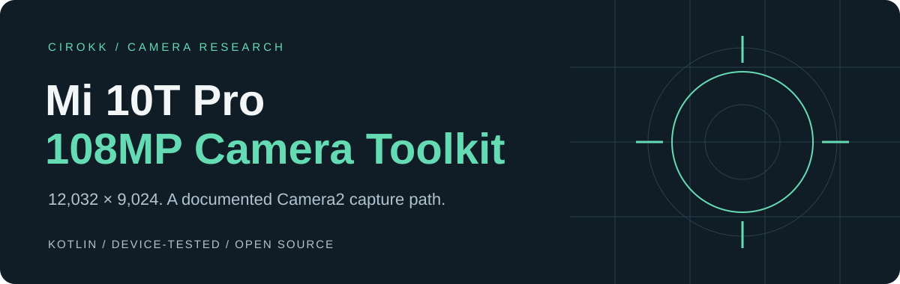

<p align="center"></p>

<p align="center">
  <a href="LICENSE"></a>
  
  
  
</p>

# Mi 10T Pro 108MP Camera Toolkit

**A documented, device-tested path to 12032 × 9024 still capture from a third-party Android Camera2 app.** Original Kotlin code, an integration guide, and the investigation behind the configuration.

Developed through hands-on investigation by **[cirokk](https://github.com/cirokk)** for the Fframe camera project. No Xiaomi application code, proprietary binaries, private photos, device logs, or signing keys are included.

> **Device-specific research, not a universal camera unlock.** The capture path was tested on a Xiaomi Mi 10T Pro (M2007J3SG, `apollo`), Android 12 / MIUI 13.0.8.0 EEA. Other firmware, ROMs and devices require separate validation. The helper has been compiled; integration into your app still needs testing.

<p align="center"><a href="docs/INTEGRATION.md"><b>Integrate with Camera2 →</b></a> &nbsp; · &nbsp; <a href="docs/GCAM.md">GCam mod developers</a> &nbsp; · &nbsp; <a href="docs/EVIDENCE.md">Evidence & limitations</a></p>

## The discovery

An advertised resolution, an `ImageReader.width` value, or even a 108 MP JPEG header does **not** prove full-resolution sensor readout. Some tested configurations produced 108 MP-sized JPEGs while the driver selected its 27 MP sensor mode.

The successful path used a Xiaomi vendor session, a zero-usage full-resolution YUV reader, and remosaic enabled from session setup through still capture:

| Component | Tested configuration |
|---|---|
| Camera | Rear main camera, ID `0` |
| Session type | `0x9004` — vendor-specific, not a portable Android mode |
| Session / preview / still tag | `xiaomi.remosaic.enabled = true` (`Boolean`) |
| Full-resolution output | `YUV_420_888`, **12032 × 9024**, `maxImages = 1`, **`usage = 0L`** |
| Preview output | `PRIVATE`, 1920 × 1440, drained rather than displayed |
| Companion output | `YUV_420_888`, 6016 × 4512, configured but not targeted by the still request |
| Export | Original stride-aware YUV conversion → NV21 → JPEG |

Keep the complete tested configuration initially. The necessity of every individual flag/output has **not** been isolated.

## What is included

- **[Kotlin adapter](toolkit/src/main/java/io/github/cirokk/mi10t108mp/Mi10TPro108MpYuv.kt):** session configuration, requests, reader ownership and full-size JPEG conversion. No additional runtime library.
- **[Integration guide](docs/INTEGRATION.md):** permissions, lifecycle, threading, saving, failure handling and host-app responsibilities.
- **[GCam integration notes](docs/GCAM.md):** where this fits in a mod's capture architecture and what has not been tested.
- **[Evidence](docs/EVIDENCE.md):** sensor-mode observations, corrected color output and rejected/intermediate paths.
- **[Troubleshooting](docs/TROUBLESHOOTING.md):** low-resolution output, swapped colors, configuration failure, memory pressure and metadata.
- **[Validation checklist](docs/VALIDATION.md):** how to evaluate a port without mistaking dimensions for sensor resolution.

## Start here

Copy the single Kotlin file into your app, or include the `toolkit` Android library module. The module declares minSdk 26; **this capture path requires API 29+**, and the tested firmware is API 31. Keep your ordinary camera path as the fallback.

```kotlin
import io.github.cirokk.mi10t108mp.Mi10TPro108MpYuv

// Run on your camera worker after retiring your ordinary capture session.
val outputs = Mi10TPro108MpYuv.createOutputs(cameraHandler)
// Install outputs.full's image listener BEFORE creating the special session.
Mi10TPro108MpYuv.createSession(device, characteristics, outputs, cameraHandler, callback)
```

This is an adapter, not a complete camera app. Your controller owns the device, permissions, AF/AE settling, timeouts, cancellation, media publication and restoration of normal preview. Follow the [complete integration sequence](docs/INTEGRATION.md) before calling it.

## Evidence at a glance

| Claim | Status |
|---|---|
| Full-size YUV delivered to an ordinary app | Observed on the tested firmware |
| Full-resolution sensor mode executed | Observed in earlier YUV diagnostic captures, including internal 12032 × 9024 RAW and BPS mode index 0 |
| JPEG 12032 × 9024 fully decoded, corrected colors inspected | Observed in diagnostic 7 using the same capture setup and revised chroma conversion |
| Four times more usable optical detail than 27 MP | **Not measured** |
| Full-resolution RAW/DNG delivered to the app | **Not established**; direct RAW experiment failed |
| Continuous visible preview using the special session | **Not validated** |
| GCam HDR+, Night Sight or arbitrary GCam mod compatibility | **Not tested** |

The sensor evidence and the final color-verified JPEG came from different diagnostic runs. See [the evidence boundaries](docs/EVIDENCE.md).

## Engineering constraints

The NV21 array alone is **162,865,152 bytes (~155.3 MiB)**, before camera buffers and JPEG encoding. Use one capture at a time, avoid full-size Bitmaps, encode off the main thread, and handle memory exhaustion. This is a still-photo path, not 108 MP video. `YuvImage` does not automatically preserve EXIF; the host app must add orientation and capture metadata.

The chroma swap in this profile is an empirically validated workaround for this specific capture configuration. **Do not apply it globally to Android cameras.**

## Build

Use JDK 17, Android SDK 34 and Gradle 8.9:

```sh
gradle :toolkit:assembleDebug :toolkit:lintDebug
```

Set `ANDROID_HOME` or provide an untracked `local.properties`. This repository intentionally does not include a Gradle wrapper binary or a prebuilt diagnostic APK. CI builds the source module. No account credentials are needed to use the code.

## Please credit this work

If this research or code helps your app, camera mod, article or video, please credit **cirokk** and link to this repository. Suggested text:

> Mi 10T Pro 108 MP access based on research and the Camera Toolkit by cirokk: https://github.com/cirokk/mi10t-pro-108mp-camera-toolkit

An About / Credits entry or README acknowledgment is appreciated. The **MIT license requires retaining its copyright and permission notice** when redistributing the code; visible project credit is an additional request, not an extra license restriction.

## Contribute

Porting to a different firmware? Share the device model, ROM version, session setup and **sanitized** results using the compatibility-report template. Do not upload bugreports, unfiltered logcat, personal photos, serial numbers or account information. See [CONTRIBUTING.md](CONTRIBUTING.md).

Independent community research. Not affiliated with Xiaomi, Google, Qualcomm or Samsung. Android and vendor interfaces remain subject to their respective compatibility constraints.
